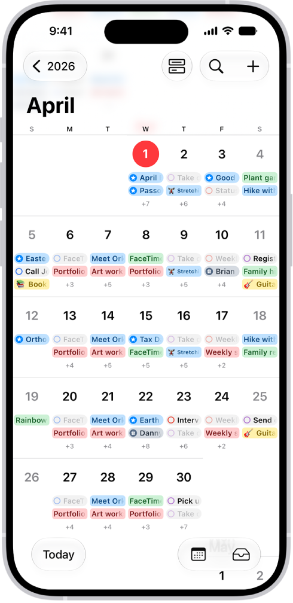
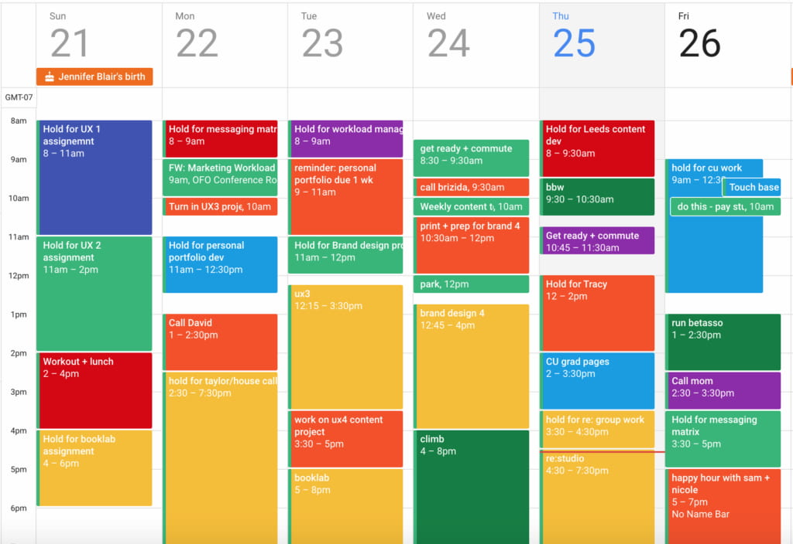
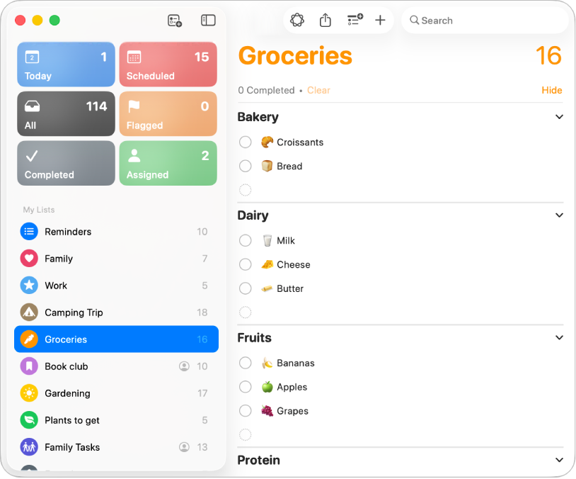
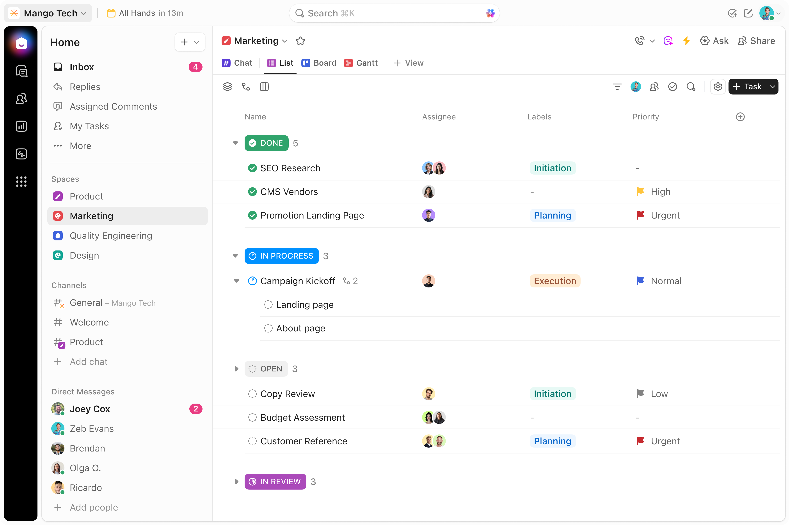
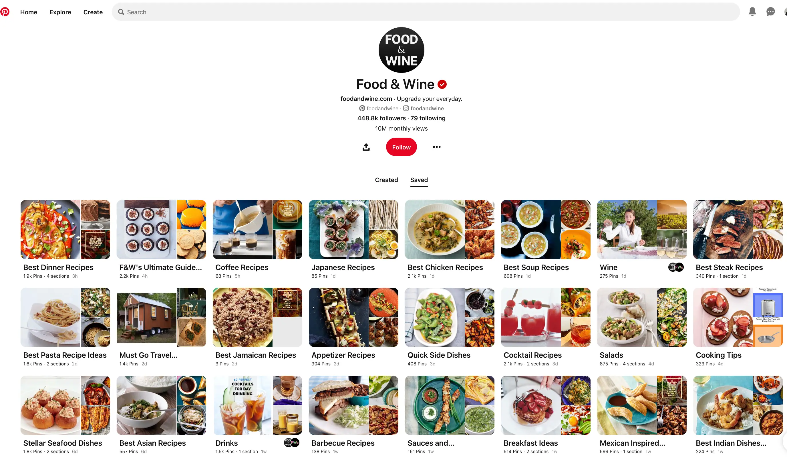
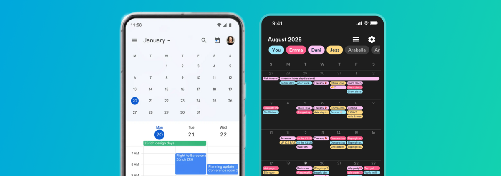
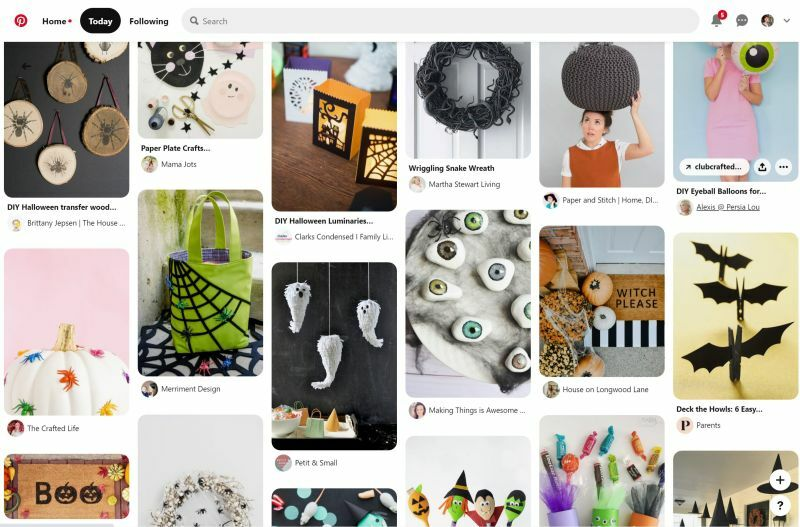
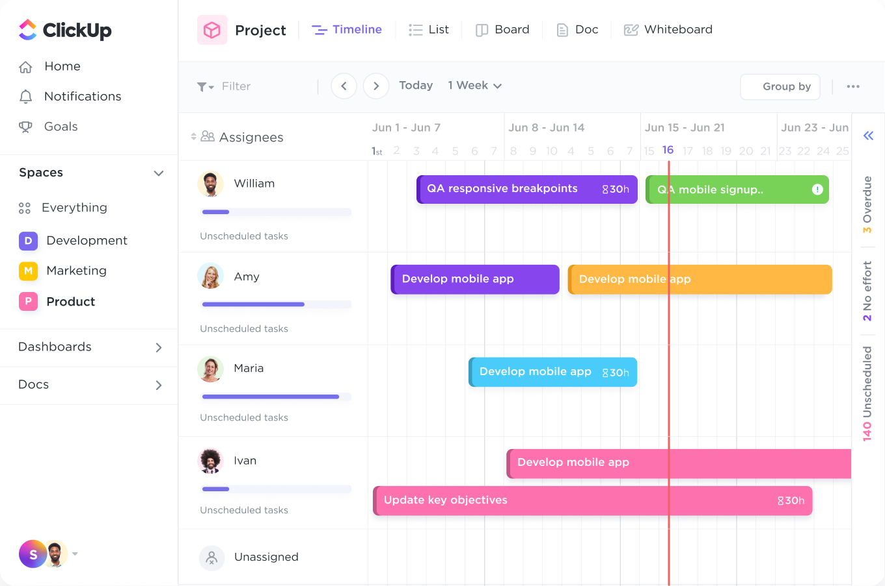

# Referenciák · Napirend tervező

## Versenytársak (4)

### 1. Apple Naptár · icloud.com/calendar

- Mit veszek át belőle: a nyugodt, szellős napi/heti áttekintést
- Mit kerülnék el: a kötöttebb rácsot, ami kevésbé kártyás és barátságos

### 2. Google Naptár · calendar.google.com

- Mit veszek át belőle: a gyors eseményfelvételt a kiválasztott napon vagy idősávon
- Mit kerülnék el: a zsúfolt felületet és a sok felesleges beállítást

### 3. Apple Emlékeztetők · icloud.com/reminders

- Mit veszek át belőle: a teendők gyors kipipálását és egyszerű listázását
- Mit kerülnék el: hogy a teendők teljesen elszakadjanak a napi programoktól

### 4. ClickUp · clickup.com

- Mit veszek át belőle: a különböző nézetek és elemek átlátható tagolását
- Mit kerülnék el: a túlbonyolított projektmenedzsment-funkciókat és sok menüt

## Minták (3)

### 5. Pinterest · táblák és kártyák · pinterest.com

- A minta: vizuális kártyákba és csoportokba rendezett tartalom hosszú szöveglista helyett
- Miért illik az appomhoz: a napi teendők és programok is könnyebben átfuthatók kártyákként

### 6. Howbout · howbout.com

- A minta: programok és napok lazább, emberibb, közösségi hangulatú megjelenítése
- Miért illik az appomhoz: így a napi tervezés nem érződik száraz, munkahelyi naptárnak

### 7. Instagram · gyors létrehozás · instagram.com

- A minta: egyetlen, azonnal kéznél lévő gomb az új elem felvételéhez
- Miért illik az appomhoz: gyorsan fel tudsz venni egy teendőt vagy programot felesleges kattintások nélkül

## Vizuális referenciák (3)

### 8. Pinterest · szellős kártyás stílus · pinterest.com

- Mit veszek át belőle: a lekerekített sarkokat és a szellős térközöket
- Mit kerülnék el: a sűrű, egymásra zsúfolt felületet

### 9. Howbout · modern, fiatalos hangulat · howbout.com

- Mit veszek át belőle: a lazább, modern, barátságos felületi hangulatot
- Mit kerülnék el: a rideg, szürke táblázatos naptár-érzetet

### 10. ClickUp · tiszta felületi rend · clickup.com

- Mit veszek át belőle: az átgondolt arányokat és az elkülönülő elemeket
- Mit kerülnék el: a túl sok apró eszköztárat, ami elvonja a figyelmet