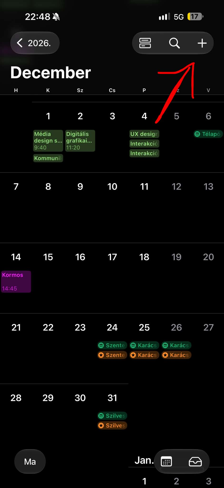
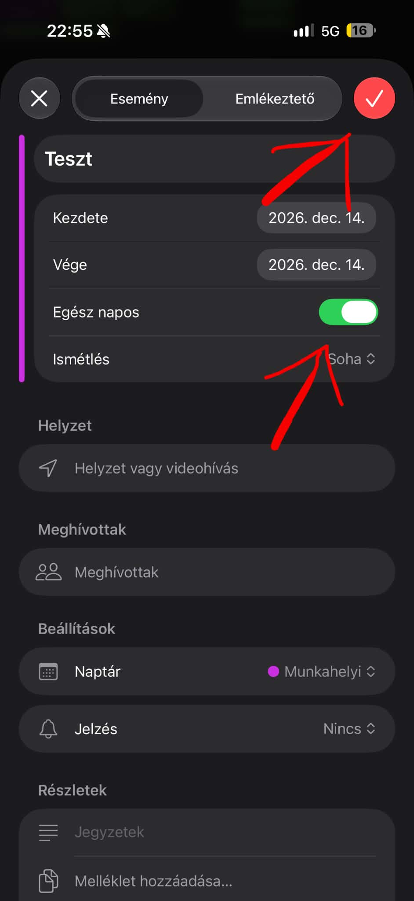
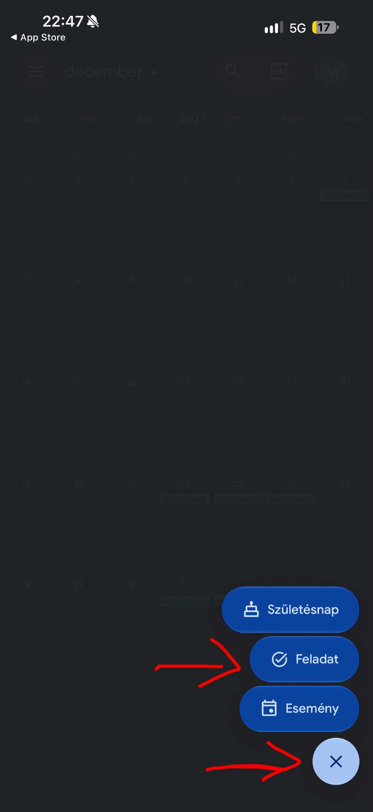
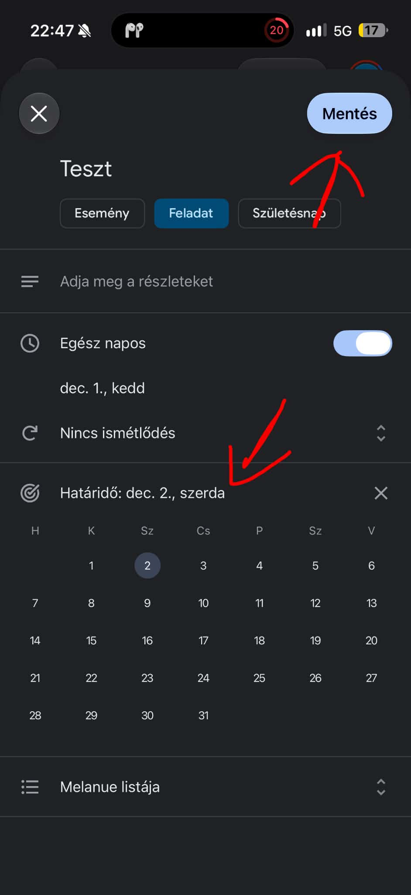
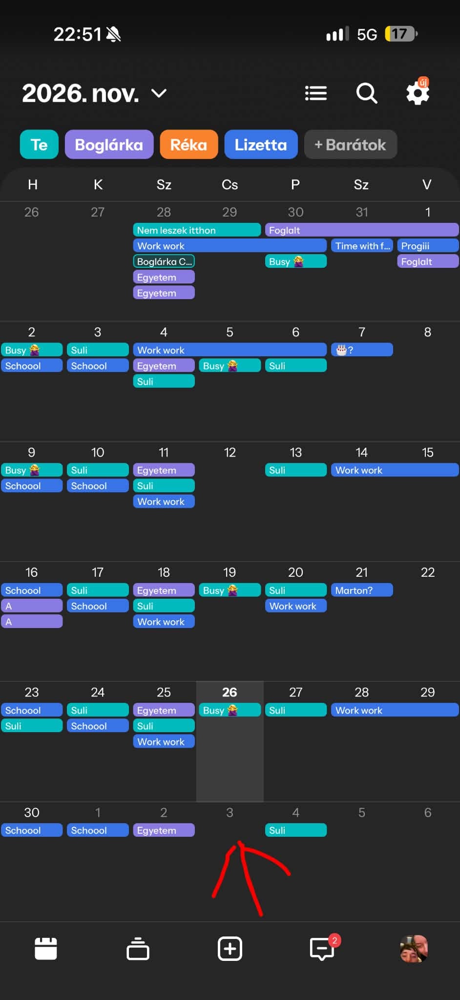
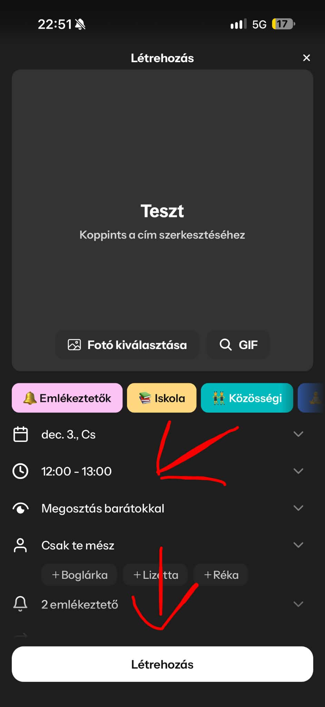

# 02-research/benchmark.md

A fő feladat, amelyet teszteltem: gyorsan felvinni és átlátni a mai teendőket és programokat
Eszköz és szélesség: iPhone 17 Pro Max, Appban

| | A: Apple Naptár | B: Google Naptár | C: Howbout |
| Koppintás célig | 4 | 4 | 4 |
| Működik | nyugodt, letisztult nézet; egy képernyőn váltható az Esemény és az Emlékeztető | gyors, elkülönített Feladat/Esemény/Születésnap választó| lazább, barátságos, színezett kártyás/címkés programhangulat |
| Nem működik | kötöttebb sávos havi/napi rács, fix piros-fekete színséma, nem vizuális kártya | zsúfoltabb űrlap sok opcióval (ismétlődés, határidő, listaválasztó), kevésbé szellős | erősen közösségi/baráti fókusz („Megosztás barátokkal”, „Csak te mész”), nem tiszta egyéni napi teendőrendszer |
| Értékelés (App Store) | "Nem kényelmes a használata: nem választható színséma, mindig a napi tervezéssel nyit, sok lépés a teljes áttekintéshez" | "Kreatív és érdekes, de nehézkes a konkrét napok és hosszabb időtartamok beállítása, és előfordulnak megjelenítési hibák" | "Napi szinten szerethető és használható, de terhelés/frissítés alatt hajlamos megakadni" |

Hiányok, amelyeket senki sem old meg: senki nem adja egyben a gyors felvitelt, a testreszabható/nyugodt esztétikát és a teendőkkel/programokkal együtt átlátható, kártyás napi nézetet kötött sávok, közösségi zaj és felesleges menük nélkül.

## Képernyőképek

### A: Apple Naptár

### B: Google Naptár

### C: Howbout

